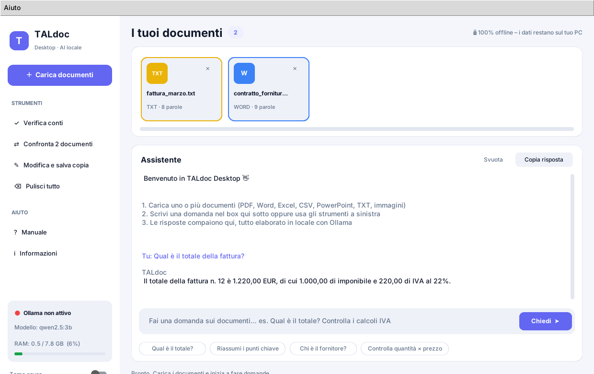

# TALdoc Desktop

App per Windows che legge i tuoi documenti **in locale** e ti permette di interrogarli con un'intelligenza artificiale che gira sul tuo PC (tramite [Ollama](https://ollama.com)).
Nessun dato viene inviato online. Pensata per ragionieri, commercialisti e professionisti.


## Cosa fa

- **Domande libere** sui documenti caricati (totali, fornitori, date, riassunti…)
- **Verifica conti**: quantità × prezzo, imponibile + IVA, somma righe = totale
- **Confronta 2 documenti** e mostra le differenze (testo, importi, date)
- **Modifica e salva copia** di un file Word con l'AI, con anteprima prima del salvataggio
- Formati supportati: PDF, Word, Excel, CSV, PowerPoint, TXT, immagini (OCR opzionale con PaddleOCR)
- Indicatore di RAM e stato di Ollama sempre visibili
- Tema **scuro** e **chiaro** commutabile

## Installazione rapida

1. Installa **Python 3.10+** da [python.org](https://www.python.org/downloads/) spuntando *Add Python to PATH*
2. Installa e avvia **Ollama** da [ollama.com](https://ollama.com)
3. Scarica questa repo (pulsante verde **Code → Download ZIP**) ed estraila
4. Fai doppio clic su **`INSTALLA_E_AVVIA.bat`**: installa le librerie e avvia l'app

Al primo avvio l'app chiede quanta RAM ha il PC e suggerisce il modello adatto. Scaricalo con:

```
ollama pull qwen2.5:3b     # 8 GB di RAM
ollama pull qwen2.5:7b     # 16 GB
ollama pull qwen2.5:14b    # 32 GB o più
```

### Avvio manuale

```
pip install -r requirements.txt
python main.py
```

### OCR su scansioni (opzionale)

```
pip install paddleocr opencv-python-headless
```

## Tema chiaro



## Privacy

Tutto avviene sul tuo computer: i documenti vengono letti in locale e le domande sono elaborate dal modello Ollama installato sul PC.
