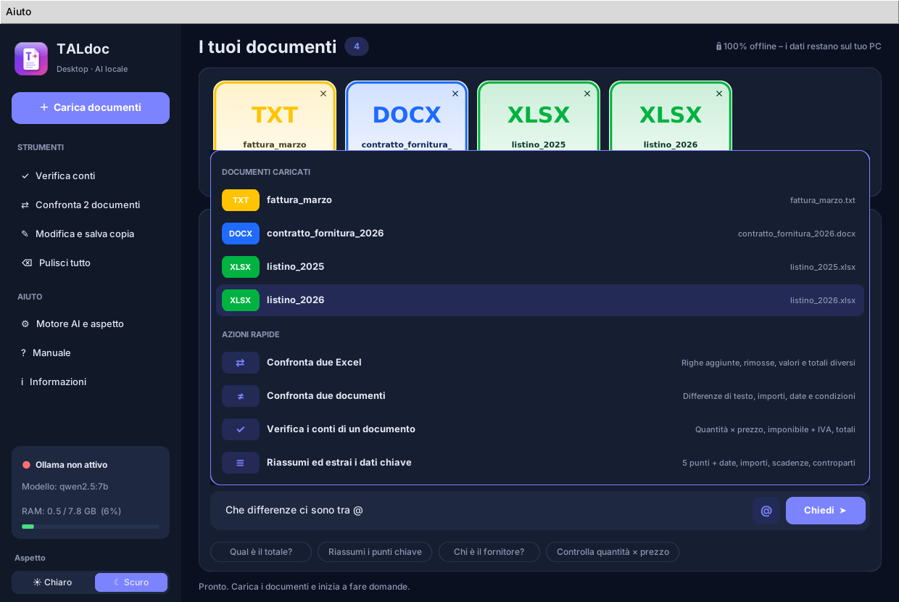
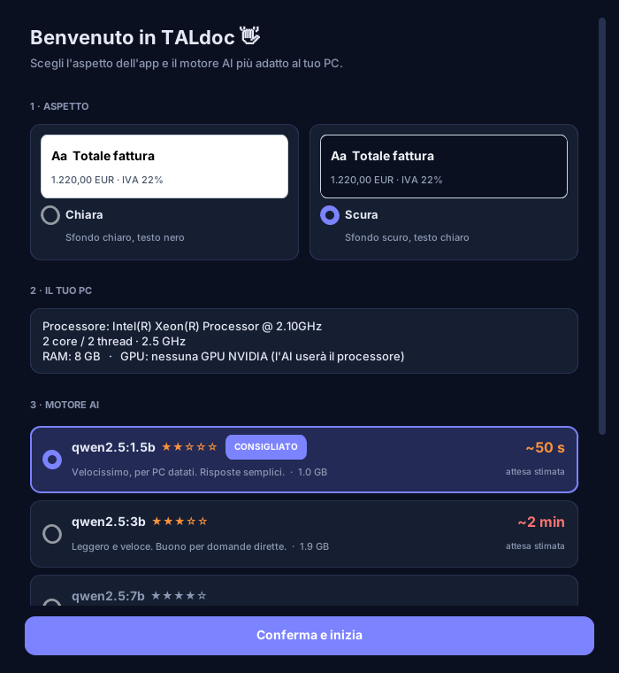

# TALdoc Desktop

App per Windows che legge i tuoi documenti **in locale** e ti permette di interrogarli con un'intelligenza artificiale che gira sul tuo PC (tramite [Ollama](https://ollama.com)).
Nessun dato viene inviato online. Pensata per ragionieri, commercialisti e professionisti.



## Cosa fa

- **Domande libere** sui documenti caricati (totali, fornitori, date, riassunti…)
- **Verifica conti**: quantità × prezzo, imponibile + IVA, somma righe = totale
- **Confronta 2 documenti** e mostra le differenze (testo, importi, date)
- **Modifica e salva copia** di un file Word con l'AI, con anteprima prima del salvataggio
- Formati supportati: PDF, Word, Excel, CSV, PowerPoint, TXT, immagini (OCR opzionale con PaddleOCR)
- **Configurazione guidata al primo avvio**: analizza processore, RAM ed eventuale GPU NVIDIA,
  mostra per ogni modello AI la qualità e i **secondi di attesa stimati** e segna come *Consigliato*
  quello con il miglior rapporto qualità/velocità. La scelta finale è dell'utente
- Scaricamento automatico del modello scelto, con barra di avanzamento
- Vista **Chiara** (sfondo chiaro, testo nero) o **Scura** (sfondo scuro, testo chiaro), sempre modificabile
- Indicatore di RAM e stato di Ollama sempre visibili

## Installazione rapida

1. Installa **Python 3.10+** da [python.org](https://www.python.org/downloads/) spuntando *Add Python to PATH*
2. Installa e avvia **Ollama** da [ollama.com](https://ollama.com)
3. Scarica questa repo (pulsante verde **Code → Download ZIP**) ed estraila
4. Fai doppio clic su **`INSTALLA_E_AVVIA.bat`**: installa le librerie e avvia l'app

Al primo avvio scegli l'aspetto e il motore AI: l'app analizza il PC, stima i tempi di risposta
e, se il modello non è ancora presente, si offre di scaricarlo da sola. In alternativa:

```
ollama pull qwen2.5:1.5b   # PC datati, 4 GB di RAM
ollama pull qwen2.5:3b     # 8 GB di RAM
ollama pull qwen2.5:7b     # 16 GB
ollama pull qwen2.5:14b    # 32 GB o GPU con 12 GB
ollama pull qwen2.5:32b    # workstation
```

### Avvio manuale

```
pip install -r requirements.txt
python main.py
```

### OCR su scansioni (opzionale)

```
pip install paddleocr opencv-python-headless
```

Puoi rifare la scelta in qualsiasi momento dal pulsante **Motore AI e aspetto** nella barra laterale.
Le impostazioni sono salvate in `%APPDATA%\TALdoc_Desktop\settings.json`.

## Configurazione guidata



## Vista chiara


## Privacy

Tutto avviene sul tuo computer: i documenti vengono letti in locale e le domande sono elaborate dal modello Ollama installato sul PC.
